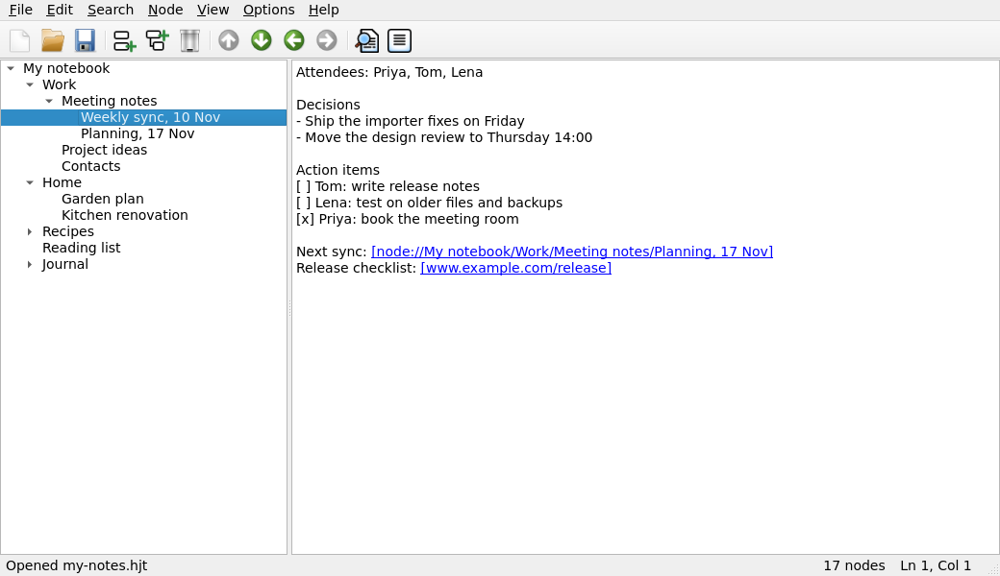
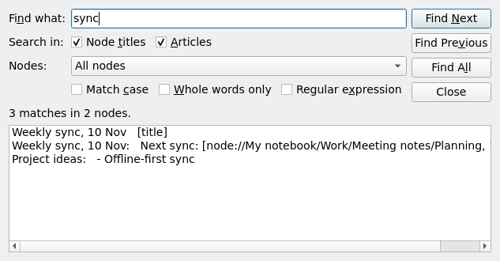

<p align="center">
  
</p>

<h1 align="center">Twigpad</h1>

<p align="center">
  <b>A fast, free hierarchical notes editor and outliner for Linux.</b><br>
  Organize notes in a tree, read and write them beside it, keep everything in one plain-text file.
</p>

<p align="center">
  <a href="https://github.com/rishabh3354/twigpad/actions/workflows/ci.yml"></a>
  <a href="LICENSE"></a>
  
  
</p>

<p align="center">
  
</p>

Twigpad is a **two-pane notes organizer**: a tree of notes on the left, the text
of the selected note on the right. Nest notes as deep as you like, move whole
branches around, and search everything at once. It works offline, needs no
account, and saves your whole notebook as a single `.hjt` file you can back up,
sync or open anywhere.

It is made for people who like a classic, keyboard-driven tree notepad: quick
to start, simple to use, and built to last.

## Contents

- [Features](#features)
- [Coming from TreePad?](#coming-from-treepad)
- [What people use it for](#what-people-use-it-for)
- [Install](#install)
- [Keyboard shortcuts](#keyboard-shortcuts)
- [FAQ](#faq)
- [Contributing](#contributing)
- [License](#license)

## Features

- **Tree of notes, unlimited depth.** Add, rename, move, sort and drag notes and whole branches.
- **Search everything.** Find and replace across all note titles and text, with a list of every match.
- **Branch clipboard.** Cut, copy and paste a note with all its subnotes, also between windows.
- **Links.** Link to websites, email addresses, files and other notes (`[node://…]`); <kbd>Ctrl</kbd>+<kbd>H</kbd> or <kbd>Ctrl</kbd>+click opens them.
- **One plain-text file.** Your notebook is a single `.hjt` file: easy to back up, sync and keep for decades.
- **Recovers what others can't.** Opens backup copies (`.bak`, `.hjt~`), zipped backups and damaged or truncated files, and saves everything it can.
- **Merge notebooks.** Combine several files or old backups into one tree.
- **Safe by default.** Keeps a backup copy when you save, writes files atomically, optional auto-save.
- **Export and print.** Export a note, a branch or the whole notebook as a text outline, or print it.
- **Fast and light.** Starts instantly, works fully from the keyboard, runs on any Linux desktop.

<p align="center">
  
</p>

## Coming from TreePad?

Twigpad reads and writes the **`.hjt` file format** used by TreePad Lite, so
you can bring your notes to Linux without Wine and without converting them:

- **Open `.hjt` files directly.** Your tree, titles and text come across as they are,
  including accented characters from Windows files.
- **Open your backups.** `.bak` copies, zipped backups and files cut off by a crash
  open as well; Twigpad saves them as a new file rather than overwriting the backup.
- **Keep using both.** Twigpad saves `.hjt` files in the Windows-compatible encoding,
  so the same file still opens on Windows.
- **Familiar keys.** <kbd>Ins</kbd> adds a child note, <kbd>Shift</kbd>+<kbd>Ins</kbd> or
  <kbd>Enter</kbd> adds one below, <kbd>Shift</kbd>+arrows move notes, <kbd>Alt</kbd>+arrows
  jump between siblings, <kbd>F2</kbd> renames, <kbd>Del</kbd> deletes.
- **Your links keep working.** `[node://…]` links between notes, and web, email and
  file links, open with <kbd>Ctrl</kbd>+<kbd>H</kbd> just as before.
- **One top note,** as in your existing files, so the structure stays compatible.

Notes formatted as rich text in other editions are opened as plain text.

If you have used other two-pane outliners such as **KeyNote NF**, **NoteCase**,
**TuxCards**, **TreeLine**, **CherryTree** or **Zim**, Twigpad will feel familiar.

## What people use it for

- **Personal knowledge base** and personal wiki: everything you know, in one searchable tree
- **Meeting notes** and project notes, one note per meeting under each project
- **Research notes**, reading notes and writing outlines for articles, books and theses
- **Journal** and diary, organized by year and month
- **Recipes**, how-tos, checklists and to-do lists
- **Code snippets**, commands and configuration notes for developers and sysadmins
- **Personal information manager (PIM)** for contacts, accounts and reference information

## Install

Twigpad needs Python 3.8+ and PyQt5.

```bash
git clone https://github.com/rishabh3354/twigpad.git
cd twigpad
pip install --user .
twigpad
```

**AppImage and Snap packages are coming soon.**

To run it from the source folder without installing:

```bash
PYTHONPATH=src python3 -m twigpad
```

## Usage

```bash
twigpad                       # open the window
twigpad notes.hjt             # open a file, a .bak backup or a .zip
twigpad --dump notes.hjt      # print a file's tree and exit
```

## Keyboard shortcuts

| Key | Action |
|---|---|
| <kbd>Ins</kbd> | Add child note |
| <kbd>Shift</kbd>+<kbd>Ins</kbd> or <kbd>Enter</kbd> / <kbd>Ctrl</kbd>+<kbd>Shift</kbd>+<kbd>Ins</kbd> | Add note below / above |
| <kbd>F2</kbd> / <kbd>Del</kbd> | Rename / delete note |
| <kbd>Shift</kbd>+arrows | Move note up, down, out or in a level |
| <kbd>Alt</kbd>+<kbd>Up</kbd> / <kbd>Down</kbd> | Previous / next note at the same level |
| <kbd>Ctrl</kbd>+<kbd>X</kbd> / <kbd>C</kbd> / <kbd>V</kbd> (in the tree) | Cut / copy / paste a branch |
| <kbd>Ctrl</kbd>+<kbd>Shift</kbd>+<kbd>S</kbd> | Sort subnotes |
| <kbd>Ctrl</kbd>+<kbd>H</kbd> | Follow the link at the cursor |
| <kbd>Ctrl</kbd>+<kbd>F</kbd> / <kbd>Ctrl</kbd>+<kbd>R</kbd> | Find / replace in all notes |
| <kbd>F3</kbd> | Find next |
| <kbd>F5</kbd> | Insert date and time |
| <kbd>F6</kbd> or <kbd>Ctrl</kbd>+<kbd>Tab</kbd> | Switch between tree and text |

All keys and menus are in the [user guide](docs/user-guide.md).

## FAQ

### How do I open `.hjt` files on Linux?

Install Twigpad and open the file with **File → Open**, or run `twigpad file.hjt`.

### Can I use my TreePad Lite files on Linux without Wine?

Yes. Twigpad is a native Linux application that reads the `.hjt` format directly.

### Will my file still open on Windows after I edit it in Twigpad?

Yes. Twigpad writes the same `.hjt` format, in the Windows-compatible encoding
whenever your text allows it.

### Can I get my notes back from a backup or a damaged file?

Open the `.bak`, `.hjt~` or `.zip` backup with **File → Open**. Damaged or
truncated files open as far as they can be read, and Twigpad lists what it
repaired. To combine several backups, use **File → Import → Tree File or Backup**.

### Do links between notes still work?

Yes. Links written as `[node://Top note/Chapter/Section]` jump to that note, and
web (`[www.…]`, `[http://…]`), email (`[mailto:…]`) and file (`[file://…]`) links
open in the usual program. Put the cursor in a link and press <kbd>Ctrl</kbd>+<kbd>H</kbd>,
or <kbd>Ctrl</kbd>+click it. To link to a note, select it and press
<kbd>Ctrl</kbd>+<kbd>Shift</kbd>+<kbd>H</kbd>, then paste the link into any text.

### Does it support formatting, images or attachments?

Not at the moment: notes are plain text, which keeps files small, fast and readable
by any text editor. Rich-text notes from other programs open as plain text.

### Does it sync between computers?

Twigpad stores everything in one file and needs no account, so you can keep that
file in any synced folder (Syncthing, Nextcloud, Dropbox and so on).

### Is it free?

Yes. Twigpad is free and open-source software under the GPL-3.0-or-later license.

## Contributing

Bug reports, feature ideas and pull requests are welcome. If a `.hjt` file does
not open correctly, please [open an issue](https://github.com/rishabh3354/twigpad/issues).
See [CONTRIBUTING.md](CONTRIBUTING.md) for the development setup and
[docs/file-format.md](docs/file-format.md) for how `.hjt` files are read and written.

If Twigpad is useful to you, a ⭐ on GitHub helps others find it.

## License

Twigpad is free software, released under the
[GNU General Public License v3.0 or later](LICENSE).

---

<sub>TreePad is a trademark of its owner. Twigpad is an independent open-source
project and is not affiliated with or endorsed by the makers of TreePad or of any
other program mentioned here. Their names are used only to describe file
compatibility and similar software.</sub>
