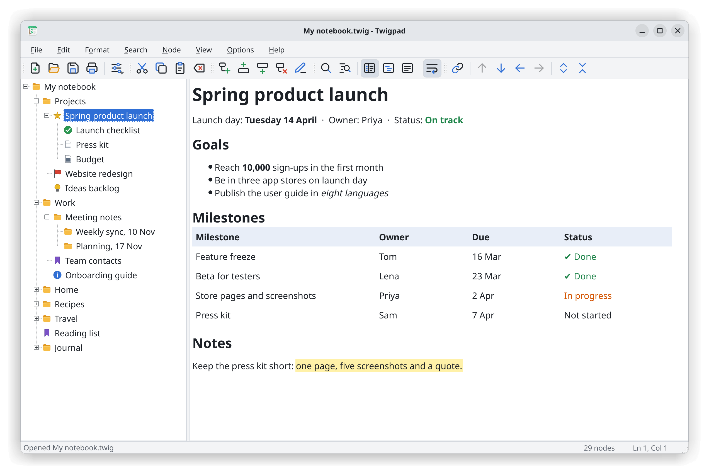
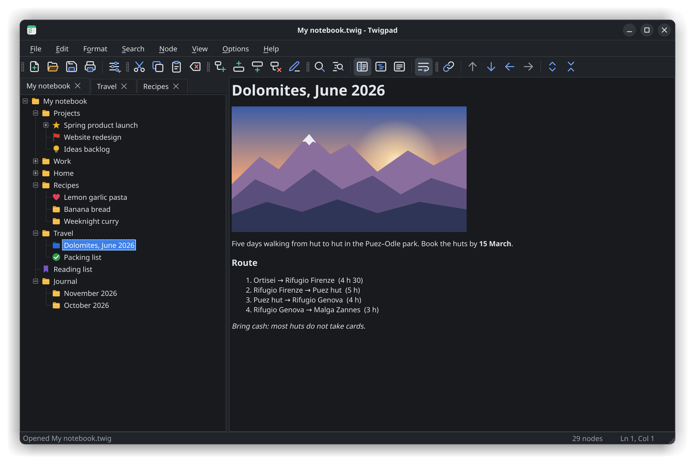
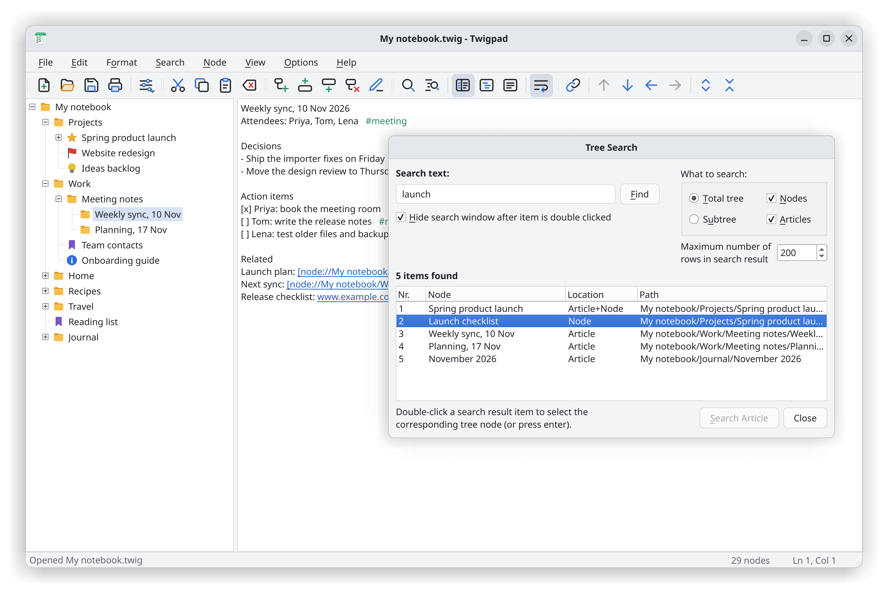
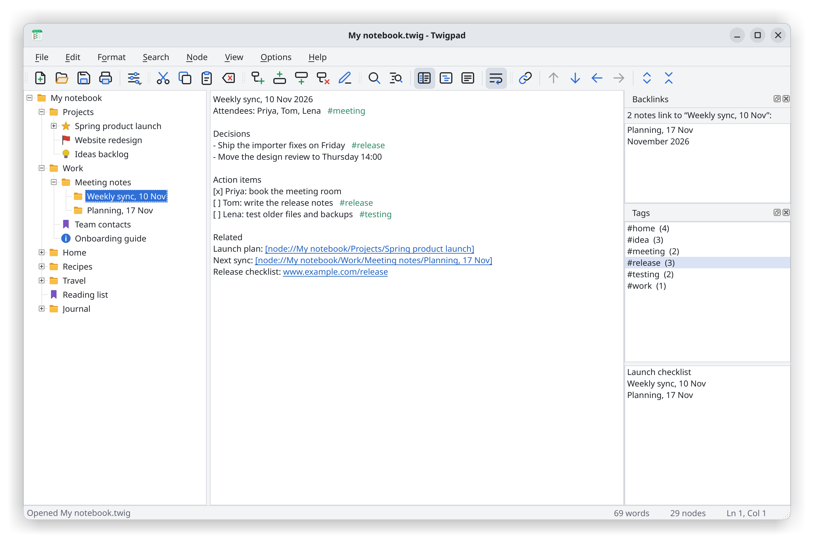
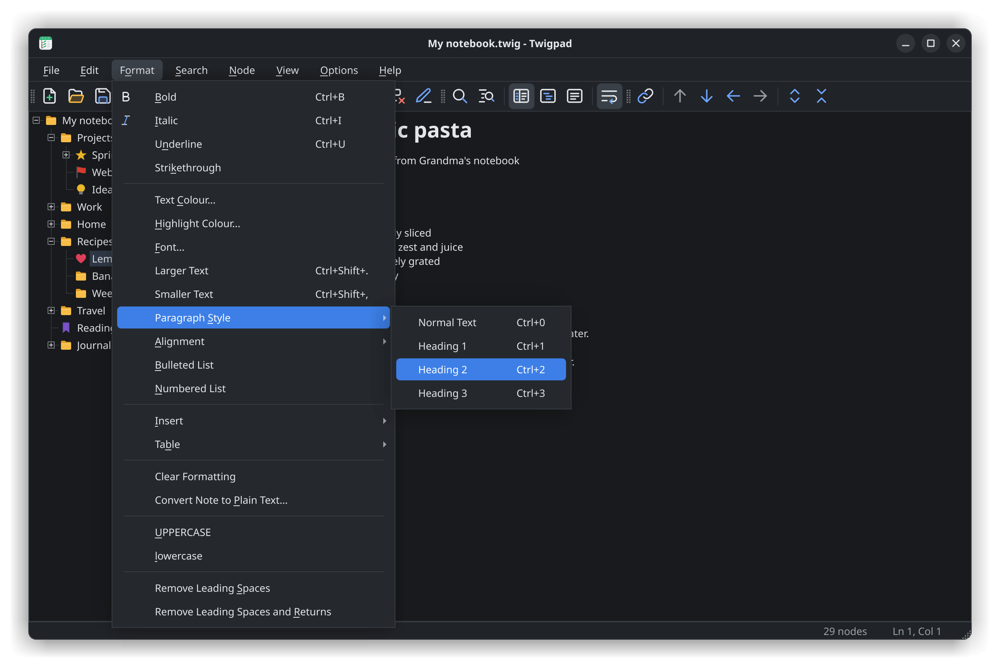

<p align="center">
  
</p>

<h1 align="center">Twigpad</h1>

<p align="center">
  <b>A fast, free hierarchical notes editor and outliner for Linux.</b><br>
  Organize notes in a tree, read and write them beside it, keep everything in one plain-text file.
</p>

<p align="center">
  <a href="https://github.com/rishabh3354/twigpad/actions/workflows/ci.yml"></a>
  <a href="LICENSE"></a>
  
  
</p>

<p align="center">
  
</p>

Twigpad is a **two-pane notes organizer**: a tree of notes on the left, the text
of the selected note on the right. Nest notes as deep as you like, move whole
branches around, and search everything at once. It works offline, needs no
account, and saves your whole notebook as a single `.hjt` file you can back up,
sync or open anywhere.

It is made for people who like a classic, keyboard-driven tree notepad: quick
to start, simple to use, and built to last.

## Contents

- [Features](#features)
- [Screenshots](#screenshots)
- [Coming from TreePad?](#coming-from-treepad)
- [What people use it for](#what-people-use-it-for)
- [Install](#install)
- [Keyboard shortcuts](#keyboard-shortcuts)
- [FAQ](#faq)
- [Contributing](#contributing)
- [Report a bug](#report-a-bug)
- [Support the developer](#support-the-developer)
- [More apps by the developer](#more-apps-by-the-developer)
- [License](#license)

## Features

- **Tree of notes, unlimited depth.** Add, rename, move, sort and drag notes and whole branches.
- **Undo everything.** Deleted, moved, sorted or pasted the wrong thing? <kbd>Ctrl</kbd>+<kbd>Z</kbd> in the tree brings it back, with all its subnotes.
- **Search everything.** Find and replace across all note titles and text, with a list of every match.
- **Branch clipboard.** Cut, copy and paste a note with all its subnotes, also between windows.
- **Links.** Link to websites, email addresses, files and other notes (`[node://…]`); <kbd>Ctrl</kbd>+<kbd>H</kbd> or <kbd>Ctrl</kbd>+click opens them.
- **Your notes in one file.** A notebook is a single `.hjt` file (plain text) or `.twig` file (with formatting and pictures): easy to back up, sync and keep for decades.
- **Recovers what others can't.** Opens backup copies (`.bak`, `.hjt~`), zipped backups and damaged or truncated files, and saves everything it can.
- **Merge notebooks.** Combine several files or old backups into one tree.
- **Safe by default.** Keeps a backup copy when you save, writes files atomically, recovers unsaved changes after a crash or power cut, optional auto-save.
- **Export and print.** Export a note, a branch or the whole notebook as a text outline or an HTML web page, save a branch as its own file, or print it.
- **Import anything.** Text files (several at once), CSV files (a note per row), other tree files and backups.
- **Clean up pasted text.** UPPERCASE, lowercase, and removing indentation, quote marks and hard line breaks from pasted email.
- **Collect snippets.** Automatic Paste adds everything you copy in other programs to the current note.
- **Formatted notes and pictures.** Bold, colours, headings, lists, tables and pictures, plus icons and colours for notes.
- **Password protection.** Encrypt a notes file with AES-256.
- **Focus and tabs.** Focus on one branch to see only it, or open branches in tabs of their own.
- **Tags and backlinks.** Write `#tags` anywhere and browse notes by tag; see which notes link to the current one.
- **Spell check and word count.** Misspelled words are underlined, with suggestions on right-click.
- **Opens from your file manager.** Double-click a `.hjt` file to open it in Twigpad (one click to set up).
- **Safe with other programs.** Warns when the file is changed by another program or a sync tool.
- **Read-only mode, tray and portable mode.** Protect a file from changes, hide to the system tray with <kbd>Ctrl</kbd>+<kbd>M</kbd>, and keep settings on a USB stick.
- **In your language.** Menus and windows in English, German, French, Spanish, Italian, Brazilian Portuguese, Russian, Simplified Chinese and Japanese; follows your desktop's language automatically (View → Language).
- **Light and dark themes.** A clean light theme and an easy-on-the-eyes dark theme, or follow your desktop automatically.
- **Comfortable to read.** A clean font and slightly larger text by default; choose your own fonts and zoom the tree or the article with <kbd>Ctrl</kbd>+mouse wheel.
- **Move to a new computer easily.** Back up all your notes files and settings into one `.zip`, and restore them on the new computer; files already there are left alone.
- **Spell check in 50 languages.** Download dictionaries from inside the app with one click.
- **Fast and light.** Starts instantly, works fully from the keyboard, runs on any Linux desktop.

## Screenshots

<table>
  <tr>
    <td width="50%" align="center">
      <br>
      <sub><b>Dark theme</b>, pictures in notes and branches open in tabs</sub>
    </td>
    <td width="50%" align="center">
      <br>
      <sub><b>Search</b> the titles and text of every note at once</sub>
    </td>
  </tr>
  <tr>
    <td width="50%" align="center">
      <br>
      <sub><b>Tags</b>, links between notes and backlinks</sub>
    </td>
    <td width="50%" align="center">
      <br>
      <sub><b>Formatting</b>: headings, lists, colours, pictures and tables</sub>
    </td>
  </tr>
</table>

## Coming from TreePad?

Twigpad reads and writes the **`.hjt` file format** used by TreePad Lite, so
you can bring your notes to Linux without Wine and without converting them:

- **Open `.hjt` files directly.** Your tree, titles and text come across as they are,
  including accented characters from Windows files.
- **Open your backups.** `.bak` copies, zipped backups and files cut off by a crash
  open as well; Twigpad saves them as a new file rather than overwriting the backup.
- **Keep using both.** Twigpad saves `.hjt` files in the Windows-compatible encoding,
  so the same file still opens on Windows.
- **Familiar keys.** <kbd>Ins</kbd> adds a child note, <kbd>Shift</kbd>+<kbd>Ins</kbd> or
  <kbd>Enter</kbd> adds one below, <kbd>Shift</kbd>+arrows move notes, <kbd>Alt</kbd>+arrows
  jump between siblings, <kbd>F2</kbd> renames, <kbd>Del</kbd> deletes.
- **Your links keep working.** `[node://…]` links between notes, and web, email and
  file links, open with <kbd>Ctrl</kbd>+<kbd>H</kbd> just as before.
- **One top note,** as in your existing files, so the structure stays compatible.
- **The everyday Lite commands are here:** Format menu, Automatic Paste, text and CSV import,
  HTML export, Next Siblings Move Right, All Children Move Left, Tree Only / Article Only
  views, read-only mode and minimize to tray.

Notes formatted as rich text in other editions are opened as plain text.

If you have used other two-pane outliners such as **KeyNote NF**, **NoteCase**,
**TuxCards**, **TreeLine**, **CherryTree** or **Zim**, Twigpad will feel familiar.

## What people use it for

- **Personal knowledge base** and personal wiki: everything you know, in one searchable tree
- **Meeting notes** and project notes, one note per meeting under each project
- **Research notes**, reading notes and writing outlines for articles, books and theses
- **Journal** and diary, organized by year and month
- **Recipes**, how-tos, checklists and to-do lists
- **Code snippets**, commands and configuration notes for developers and sysadmins
- **Personal information manager (PIM)** for contacts, accounts and reference information

## Install

### AppImage (any Linux distribution)

[Download the latest AppImage](https://github.com/rishabh3354/twigpad/releases/latest/download/Twigpad-x86_64.AppImage)
(this link always gives the newest version), make it executable and start it:

```bash
curl -LO https://github.com/rishabh3354/twigpad/releases/latest/download/Twigpad-x86_64.AppImage
chmod +x Twigpad-x86_64.AppImage
./Twigpad-x86_64.AppImage
```

Each version is also on the [releases page](https://github.com/rishabh3354/twigpad/releases)
as `Twigpad-<version>-x86_64.AppImage`.

It brings its own Python, Qt, PyCryptodome and Hunspell spell checker, and runs
without FUSE 2. To open `.hjt` and `.twig` files by double-clicking them, choose
**Options → Open .hjt Files with Twigpad** (or add the AppImage with
AppImageLauncher or Gear Lever). Put an empty `twigpad.ini` beside the AppImage
to keep the settings there, for running from a USB stick.

### Snap

```bash
sudo snap install twigpad
```

The snap can open notes in your home folder. For notes on USB sticks and other
drives, allow it once with `sudo snap connect twigpad:removable-media`. To open
`.hjt` files from the file manager, right-click one and use **Open With**.

### With pip

Twigpad needs Python 3.8+ and PyQt5. Password protection also needs
PyCryptodome (`pip install` adds it; on Debian or Ubuntu it is the
`python3-pycryptodome` package).

```bash
git clone https://github.com/rishabh3354/twigpad.git
cd twigpad
pip install --user .
twigpad
```

To run it from the source folder without installing:

```bash
PYTHONPATH=src python3 -m twigpad
```

## Usage

```bash
twigpad                       # open the window
twigpad notes.hjt             # open a file, a .bak backup or a .zip
twigpad --dump notes.hjt      # print a file's tree and exit
```

## Keyboard shortcuts

| Key | Action |
|---|---|
| <kbd>Ins</kbd> | Add child note |
| <kbd>Shift</kbd>+<kbd>Ins</kbd> or <kbd>Enter</kbd> / <kbd>Ctrl</kbd>+<kbd>Shift</kbd>+<kbd>Ins</kbd> | Add note below / above |
| <kbd>F2</kbd> / <kbd>Del</kbd> | Rename / delete note |
| <kbd>Shift</kbd>+arrows | Move note up, down, out or in a level |
| <kbd>Alt</kbd>+<kbd>Up</kbd> / <kbd>Down</kbd> | Previous / next note at the same level |
| <kbd>Ctrl</kbd>+<kbd>X</kbd> / <kbd>C</kbd> / <kbd>V</kbd> (in the tree) | Cut / copy / paste a branch |
| <kbd>Ctrl</kbd>+<kbd>Shift</kbd>+<kbd>S</kbd> | Sort subnotes |
| <kbd>Ctrl</kbd>+<kbd>Z</kbd> / <kbd>Ctrl</kbd>+<kbd>Y</kbd> (in the tree) | Undo / redo a change to the tree |
| <kbd>Ctrl</kbd>+<kbd>H</kbd> | Follow the link at the cursor |
| <kbd>Ctrl</kbd>+<kbd>F</kbd> / <kbd>Ctrl</kbd>+<kbd>R</kbd> | Find / replace in all notes |
| <kbd>F3</kbd> | Find next |
| <kbd>F5</kbd> | Insert date and time |
| <kbd>Ctrl</kbd>+<kbd>B</kbd> / <kbd>I</kbd> / <kbd>U</kbd> | Bold / italic / underline |
| <kbd>F6</kbd> or <kbd>Ctrl</kbd>+<kbd>Tab</kbd> | Switch between tree and text |
| <kbd>Ctrl</kbd>+<kbd>]</kbd> / <kbd>Ctrl</kbd>+<kbd>[</kbd> | Focus on the branch / focus out one level |
| <kbd>Ctrl</kbd>+<kbd>T</kbd> / <kbd>Ctrl</kbd>+<kbd>W</kbd> | Open the branch in a new tab / close the tab |
| <kbd>Ctrl</kbd>+<kbd>Shift</kbd>+<kbd>B</kbd> / <kbd>G</kbd> | Backlinks / Tags panel |
| <kbd>Ctrl</kbd>+<kbd>M</kbd> | Minimize to the system tray |

Press <kbd>F1</kbd> in Twigpad for the full list with a search box. All keys and menus are also in the
[user guide](docs/user-guide.md).

## FAQ

### How do I open `.hjt` files on Linux?

Install Twigpad and open the file with **File → Open**, or run `twigpad file.hjt`.
To open `.hjt` files by double-clicking them, choose **Options → Open .hjt Files with Twigpad**
(with the snap, right-click a file and use **Open With** instead).

### Can I use my TreePad Lite files on Linux without Wine?

Yes. Twigpad is a native Linux application that reads the `.hjt` format directly.

### Will my file still open on Windows after I edit it in Twigpad?

Yes. Twigpad writes the same `.hjt` format, in the Windows-compatible encoding
whenever your text allows it.

### Can I get my notes back from a backup or a damaged file?

Open the `.bak`, `.hjt~` or `.zip` backup with **File → Open**. Damaged or
truncated files open as far as they can be read, and Twigpad lists what it
repaired. To combine several backups, use **File → Import → Tree File or Backup**.

### Do links between notes still work?

Yes. Links written as `[node://Top note/Chapter/Section]` jump to that note, and
web (`[www.…]`, `[http://…]`), email (`[mailto:…]`) and file (`[file://…]`) links
open in the usual program. Put the cursor in a link and press <kbd>Ctrl</kbd>+<kbd>H</kbd>,
or <kbd>Ctrl</kbd>+click it. To link to a note, select it and press
<kbd>Ctrl</kbd>+<kbd>Shift</kbd>+<kbd>H</kbd>, then paste the link into any text.

### Does it support formatting, images or password protection?

Yes. Notes can have bold, italic, colours, headings, lists, tables and pictures,
note icons and colours, and a file can be encrypted with a password. These are
saved in Twigpad's own `.twig` files; `.hjt` files stay plain text, so they keep
working with other programs. Attachments (other file types) are not supported:
link to the file instead with **Edit → Insert → Link to File**.

### Does it sync between computers?

Twigpad stores everything in one file and needs no account, so you can keep that
file in any synced folder (Syncthing, Nextcloud, Dropbox and so on).

### How do I move my notes to a new computer?

Use **File → Backup & Restore → Back Up Notes and Settings** on the old computer and
**Restore from Backup** on the new one. Files that are already there are not overwritten.

### Is it free?

Yes. Twigpad is free and open-source software under the GPL-3.0-or-later license.

## Contributing

Bug reports, feature ideas and pull requests are welcome. If a `.hjt` file does
not open correctly, please [open an issue](https://github.com/rishabh3354/twigpad/issues).
See [CONTRIBUTING.md](CONTRIBUTING.md) for the development setup and
[docs/file-format.md](docs/file-format.md) for how `.hjt` files are read and written.

If Twigpad is useful to you, a ⭐ on GitHub helps others find it.

## Report a bug

Use **Help → Report a Bug** in Twigpad (or **Help → Request a Feature** for ideas), or
[open an issue on GitHub](https://github.com/rishabh3354/twigpad/issues/new?labels=bug).
The menu item fills in your Twigpad, Qt, Python and Linux versions for you.

## Support the developer

Twigpad is free and made by [Rishabh Bhardwaj](https://warlordsoftwares.com/rishabh-bhardwaj/) at
[Warlord Softwares](https://warlordsoftwares.com/). If it saves you time, you can support its
development with a donation:

**[Donate with PayPal](https://paypal.me/TechRishabh/10)**

## More apps by the developer

- **[PDF 30-in-1 PRO](https://warlordsoftwares.com/trending-apps/pdf-30-in-1-offline-pdf-editor-and-converter/)**: Merge, split, convert, compress, sign and OCR PDF files, all offline
- **[4KTUBE PRO](https://warlordsoftwares.com/trending-apps/4ktube-pro-best-youtube-video-downloader-linux/)**: Download YouTube videos, playlists and audio in up to 4K quality
- **[4KWALL PRO](https://warlordsoftwares.com/trending-apps/4kwall-modern-wallpaper-app-with-auto-wallpaper-changer/)**: Find beautiful high-resolution wallpapers and change them automatically
- **[FORMAT LAB PRO](https://warlordsoftwares.com/trending-apps/formatlab-pro-convert-or-compress-video-audio-formats-one-click/)**: Convert and compress video and audio files in one click
- **[Torrent4K PRO](https://warlordsoftwares.com/trending-apps/torrent4k-torrent-client-and-video-player/)**: Torrent client that lets you watch videos while they download
- **[PDF2OCR PRO](https://warlordsoftwares.com/trending-apps/pdf2go-convert-imagespdf-text-uding-ocr-technology/)**: Turn scanned pages and images into text you can copy and search (free)
- **[JPEG2PDF PRO](https://warlordsoftwares.com/trending-apps/jpg2pdf-pro-convert-your-images-pdfs/)**: Combine a folder of pictures into one PDF (free)
- **[SpeedX](https://warlordsoftwares.com/trending-apps/speedx-system-monitor-app-linux/)**: Live internet speed and system monitor for your desktop (free)

See [all Linux apps by Warlord Softwares](https://warlordsoftwares.com/apps/linux-apps/).

## License

Twigpad is free software, released under the
[GNU General Public License v3.0 or later](LICENSE).

---

<sub>TreePad is a trademark of its owner. Twigpad is an independent open-source
project and is not affiliated with or endorsed by the makers of TreePad or of any
other program mentioned here. Their names are used only to describe file
compatibility and similar software.</sub>
